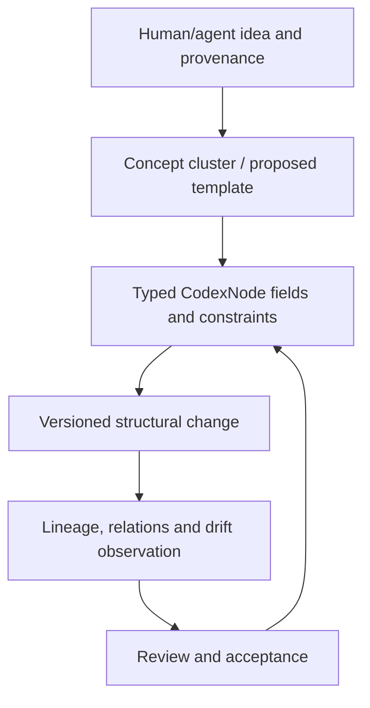

# WISDOMNET · TEMPLATE DRAFTER

### Knowledge structures should evolve without losing their lineage.

**Recursive schema research · symbolic nodes · template provenance · human/agent co-design**

A long-lived symbolic system needs more than a collection of JSON documents. The structures that organize knowledge must themselves be inspectable and versioned: where a field came from, how a concept was grouped, which constraints changed, and what an agent should or should not infer from a revised template.

**WisdomNET Template Drafter** is the LOG.OS/CodexNode design workspace exploring that idea. The intended system describes composable templates, symbolic metadata, drift/lineage tracking, recursive template operations and human/AI interfaces for developing schemas over time.

> **Current repository boundary:** this GitHub tree contains project documentation, design references, a React-based UI source area and an archived ZIP. Several commands and folders shown in earlier documentation describe a **larger envisioned/external source layout**; they are **not all present as executable files in the current Git tree**. This README does not claim a fully operating symbolic API, neural training service or authenticated deployment.

**[Architecture](docs/ARCHITECTURE.md)** · **[Deep-learning design](docs/DEEP_LEARNING_INTEGRATION.md)** · **[Visualization design](docs/VISUALIZATION_INTEGRATION.md)** · **[Versioning concepts](docs/script_versioning_guide.md)**

---

## A codex that can explain its own evolution



A template authoring engine becomes more useful when its changes have semantic receipts: not just that the text changed, but how the accepted schema changed and which downstream nodes may require a migration.

### Intended research domains

| Concern | Design objective |
|---|---|
| **Symbolic structures** | Typed CodexNodes and explicitly named relationships |
| **Template composition** | Reusable schema elements that can be nested or evolved |
| **Provenance** | Origin and attribution for fields, constraints and derived templates |
| **Drift analysis** | Compare revisions without silently changing the meaning of existing instances |
| **Human review** | Explain proposed schema changes and keep approval authority explicit |
| **Learning/embeddings** | Research candidate for discovery of structural similarity—not a proven neural service |

## What is presently in Git

The `src/ui/` tree holds React interface code, while `docs/` contains the architectural and visualization design documents. The root `package.json` specifies React Scripts and a local API proxy. The source tree visible from GitHub does **not** include all of the Python API, neural training and CLI paths named in the earlier README.

This is therefore best treated as a **design/source recovery checkpoint**. Before describing the complete template engine as runnable, restore the missing named source modules from the preserved originals and verify them with a manifest and tests.

## Minimal source investigation

```bash
git clone https://github.com/sev-32/WisdomNET-Template-Drafter.git
cd WisdomNET-Template-Drafter
npm install
```

The historical `npm start` script is declared by the package, but the complete React build entry/required files should be verified before treating it as a functioning application. Do not fabricate missing API endpoints or sample template data to claim that archival parity is complete.

## Connection to ontology and intelligent tooling

WisdomNET's premise aligns with larger efforts toward verifiable AI and symbolic memory: structured ideas should retain their origin, and machine assistance should expose changes as reviewable proposals instead of losing meaning through repeated rewriting.

**The aim is a knowledge system that can change—and still explain what it used to mean.**

---

*This README distinguishes architectural design from independently demonstrated implementation; no source modules were modified.*
